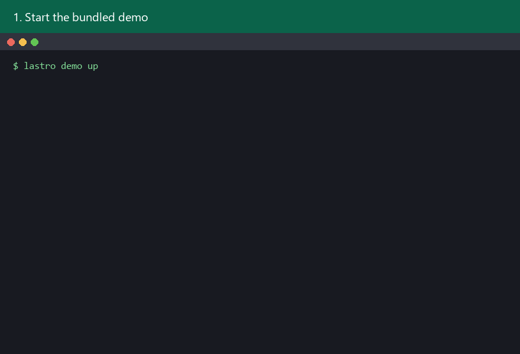
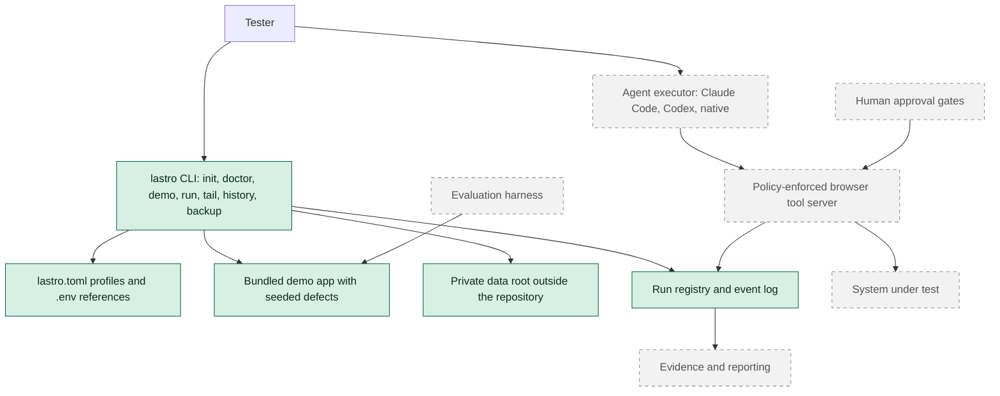

# Lastro

Lastro is an open-source Python harness that lets an AI agent perform supervised exploratory testing of web applications, where every reported conclusion is backed by evidence.



> **Project status: early development (v0.1.0, unreleased).** The repository currently ships the CLI foundation (`lastro init`, `lastro doctor`, `lastro demo`) and a bundled demo application with seeded defects. The agent runtime that runs a full test mission is planned and not available yet. Everything below describes what exists today and marks planned work as planned.

## What Lastro guarantees / does not guarantee

Lastro only lists guarantees that an automated test in this repository demonstrates. The full list, with a link to each test, lives in [SECURITY.md](SECURITY.md).

**Guaranteed today:**

- `lastro init` writes configuration templates and never writes secret values.
- `lastro doctor` fails when the private data root is inside a Git working tree or when `.env` is not git-ignored.
- The repository ignores secrets, browser session material, private evidence and local databases, and the pre-commit hook blocks commits that contain detectable secrets.
- The bundled demo listens on `127.0.0.1` only and its seeded defect catalog is never shipped in the package or served by the app.

**Not guaranteed:**

- Lastro cannot prevent an executor configured without the provided permission rules from reaching the target system by other means.
- The policy-enforcing browser tool server, human approval gates and execution limits are planned. Until they exist, Lastro does not control what an agent does on a target system.
- Secret scanning catches known secret formats only; it does not detect every possible credential.

## Quickstart

Requirements: [uv](https://docs.astral.sh/uv/) and Git. uv installs Python 3.12 when needed.

```bash
git clone https://github.com/JoaoVictorVM/lastro.git
cd lastro
uv tool install .
lastro demo up
lastro demo down
```

`lastro demo up` starts the demo at `http://127.0.0.1:8765` and prints the names of the environment variables that hold the test logins. The fictitious default values live in [`src/lastro_demo/.env.example`](src/lastro_demo/.env.example). The demo UI is in Brazilian Portuguese on purpose, to mirror a real Brazilian back-office system. Run `lastro demo down` when you are done.

This quickstart installs Lastro and runs the demo. Running a complete agent mission against the demo depends on the agent runtime, which is not available yet; see the [roadmap](#roadmap).

## Architecture



Solid green nodes are implemented today. Dashed grey nodes are planned.

## Evaluation results

| Metric | Latest result |
|---|---|
| Seeded defects detected | Not measured yet |
| False positives | Not measured yet |
| Mission criteria met | Not measured yet |

No evaluation has been run yet, so this table intentionally shows no numbers. Evaluation results will be published here, with a link to the full sanitized results, once the evaluation harness exists.

## Supported executors

| Executor | Status |
|---|---|
| Claude Code | Setup only today: `lastro init` writes its permission configuration and `lastro doctor` checks that the `claude` CLI is installed. Agent runs are planned. |
| Codex | Planned |
| Native LangGraph executor | Planned |

## Run history and backup

Every run is recorded in a SQLite database at `<private data root>/<project_id>/history.sqlite`, next to one folder per run under `runs/`. The `project_id` lives in `lastro.toml` and is shared by all profiles of the project. Projects created before it existed are migrated by running `lastro init` again, which adds only that field and keeps every other value.

- `lastro --profile <name> run start --mission "..."` (or `--mission-file missions/<file>.md`) records the run before anything touches the target system and prints the run id and folder.
- `lastro tail [run id]` follows the events of the active run, or of the given run.
- `lastro history list` lists past runs, with `--flow`, `--status`, `--issue`, `--profile`, `--since` (for example `7d`) and `--limit` (default 20).
- `lastro backup <dest>` writes one zip archive with `manifest.json` and a `<project_id>/` folder holding `history.sqlite` and `runs/`. The database copy comes from SQLite's online backup API, so the archive has no `-wal` or `-shm` files. The archive is published only after it is complete, and an existing file is never overwritten. When `<dest>` is an existing folder, the archive gets a generated name.

### Restoring a backup

There is no restore command and a restore never merges with existing history. To restore by hand:

1. Create an empty folder and extract the whole archive into it, keeping the relative paths.
2. Before opening anything, check every file against the manifest. From the repository checkout, `uv run python -c "from pathlib import Path; from lastro.history import verify_restored_backup; print(verify_restored_backup(Path('<folder>')) or 'ok')"` prints `ok` or the files that do not match.
3. Point `private_data_root` in a `lastro.toml` with the same `project_id` to that folder and run `lastro history list`. The output matches the history at backup time.
4. To make the restored copy the project history, stop Lastro, move the current `<private data root>/<project_id>` folder aside and move the restored `<project_id>` folder into its place.

## Roadmap

Each release adds one capability and ends with a measurable result.

| Release | Contents | Status |
|---|---|---|
| v0.1 | Walking skeleton: CLI, bundled demo, repository safeguards, agent runtime | In progress |
| v0.2 | Human approval gates | Planned |
| v0.3 | Evaluation and reproduction | Planned |
| v0.4 | Persistent memory | Planned |
| v0.5 | Codex executor | Planned |
| v0.6 | Native executor and observability | Planned |
| v0.7 | Change context from issues and Git | Planned |
| v0.8 | Knowledge sources | Planned |
| v0.9 | Independent verification | Planned |
| v1.0 | Autonomous mode | Planned |

## Contributing and security

See [CONTRIBUTING.md](CONTRIBUTING.md) for setup, quality checks and commit conventions, and [SECURITY.md](SECURITY.md) to report a vulnerability privately. Participation is governed by the [Code of Conduct](CODE_OF_CONDUCT.md). Release notes live in [CHANGELOG.md](CHANGELOG.md).

## License

Lastro is licensed under the [Apache License 2.0](LICENSE). See [NOTICE](NOTICE) and [THIRD_PARTY_NOTICES.md](THIRD_PARTY_NOTICES.md) for attributions.
