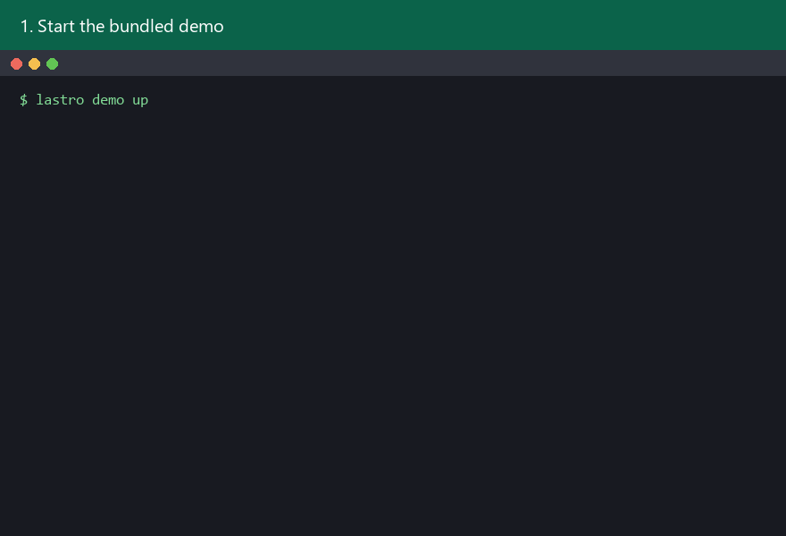
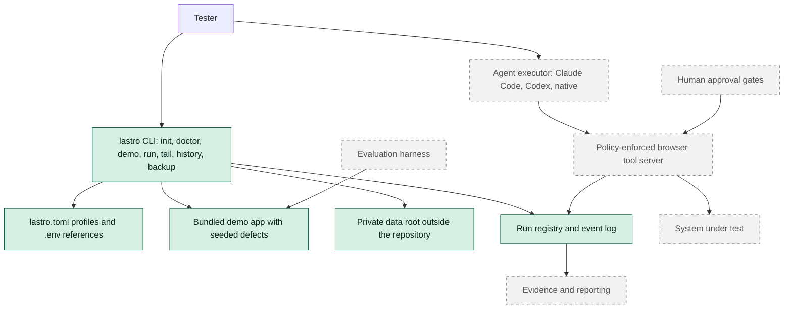

# Lastro

Lastro is an open-source Python harness that lets an AI agent perform supervised exploratory testing of web applications, where every reported conclusion is backed by evidence.



> **Project status: early development (v0.1.0, unreleased).** The repository currently ships the CLI foundation (`lastro init`, `lastro doctor`, `lastro demo`) and a bundled demo application with seeded defects. The agent runtime that runs a full test mission is planned and not available yet. Everything below describes what exists today and marks planned work as planned.

## What Lastro guarantees / does not guarantee

Lastro only lists guarantees that an automated test in this repository demonstrates. The full list, with a link to each test, lives in [SECURITY.md](SECURITY.md).

**Guaranteed today:**

- `lastro init` writes configuration templates and never writes secret values.
- `lastro doctor` fails when the private data root is inside a Git working tree or when `.env` is not git-ignored.
- The repository ignores secrets, browser session material, private evidence and local databases, and the pre-commit hook blocks commits that contain detectable secrets.
- The bundled demo listens on `127.0.0.1` only and its seeded defect catalog is never shipped in the package or served by the app.

**Not guaranteed:**

- Lastro cannot prevent an executor configured without the provided permission rules from reaching the target system by other means.
- The policy-enforcing browser tool server, human approval gates and execution limits are planned. Until they exist, Lastro does not control what an agent does on a target system.
- Secret scanning catches known secret formats only; it does not detect every possible credential.

## Quickstart

Requirements: [uv](https://docs.astral.sh/uv/) and Git. uv installs Python 3.12 when needed.

```bash
git clone https://github.com/JoaoVictorVM/lastro.git
cd lastro
uv tool install .
lastro demo up
lastro demo down
```

`lastro demo up` starts the demo at `http://127.0.0.1:8765` and prints the names of the environment variables that hold the test logins. The fictitious default values live in [`src/lastro_demo/.env.example`](src/lastro_demo/.env.example). The demo UI is in Brazilian Portuguese on purpose, to mirror a real Brazilian back-office system. Run `lastro demo down` when you are done.

This quickstart installs Lastro and runs the demo. Running a complete agent mission against the demo depends on the agent runtime, which is not available yet; see the [roadmap](#roadmap).

## Architecture



Solid green nodes are implemented today. Dashed grey nodes are planned.

## Evaluation results

| Metric | Latest result |
|---|---|
| Seeded defects detected | Not measured yet |
| False positives | Not measured yet |
| Mission criteria met | Not measured yet |

No evaluation has been run yet, so this table intentionally shows no numbers. Evaluation results will be published here, with a link to the full sanitized results, once the evaluation harness exists.

## Supported executors

| Executor | Status |
|---|---|
| Claude Code | Setup only today: `lastro init` writes its permission configuration and `lastro doctor` checks that the `claude` CLI is installed. Agent runs are planned. |
| Codex | Available for your own Codex CLI and ChatGPT login: `lastro run start --executor codex` creates the run and `lastro run launch` opens the supervised session over the same MCP tool server and skill bundle. Verified without inference on Windows; a full mission with real inference is not verified yet. See [docs/codex-executor.md](docs/codex-executor.md). |
| Native LangGraph executor | Available with the `native` extra: `lastro run start --executor native` runs the mission with Lastro's own agent loop over the same MCP tool server, with approval prompts in the terminal and a per-run cost cap. See [docs/native-executor.md](docs/native-executor.md). |

## Scripted login and tenant check

Each profile logs in through a deterministic Playwright script. The username and password are read only from the environment variables named in `[profiles.<name>.credentials]`, so they never reach the model, the history or any output. The `[profiles.<name>.auth]` block holds the login selectors, an optional tenant selection step and the ordered tenant verification methods (`api`, `cookie`, `jwt`, `page`). The defaults work with the demo. A profile with `allowed_entities` needs at least one verification method.

The browser session is saved as Playwright storage state at `<private data root>/<project_id>/.auth/<profile>.json`, readable only by the current user, and reused for at most 8 hours. Run `playwright install chromium` once before the first login.

- `lastro auth check --profile <name>` logs in, verifies the active tenant and prints `Logged in as <user> · tenant verified: <tenant name> (<method>)`. When no verification method exposes the user, it prints `Logged in for profile <name> · tenant verified: <tenant name> (<method>)`. It never starts a run or writes to the history. A missing credential variable, a failed login, a tenant mismatch or a tenant that cannot be verified exits with code 2.

## Run history and backup

Every run is recorded in a SQLite database at `<private data root>/<project_id>/history.sqlite`, next to one folder per run under `runs/`. The `project_id` lives in `lastro.toml` and is shared by all profiles of the project. Projects created before it existed are migrated by running `lastro init` in the project folder: with a valid `lastro.toml` that has no `project_id`, it asks no questions, adds only that field, keeps every other value and exits successfully. Running it again later never changes an existing `project_id`.

- `lastro --profile <name> run start --mission "..."` (or `--mission-file missions/<file>.md`) records the run before anything touches the target system and prints the run id and folder.
- `lastro tail [run id]` follows the events of the active run, or of the given run.
- `lastro history list` lists past runs, with `--flow`, `--status`, `--issue`, `--profile`, `--since` (for example `7d`) and `--limit` (default 20).
- `lastro backup <dest>` writes one zip archive with `manifest.json` and a `<project_id>/` folder holding `history.sqlite` and `runs/`. The database copy comes from SQLite's online backup API, so the archive has no `-wal` or `-shm` files. The archive is published only after it is complete, and an existing file is never overwritten. When `<dest>` is an existing folder, the archive gets a generated name.

### Restoring a backup

There is no restore command and a restore never merges with existing history. To restore by hand:

1. Create an empty folder and extract the whole archive into it, keeping the relative paths.
2. Before opening anything, check every file against the manifest. From the repository checkout, `uv run python -c "from pathlib import Path; from lastro.history import verify_restored_backup; print(verify_restored_backup(Path('<folder>')) or 'ok')"` prints `ok` or the files that do not match.
3. Point `private_data_root` in a `lastro.toml` with the same `project_id` to that folder and run `lastro history list`. The output matches the history at backup time.
4. To make the restored copy the project history, stop Lastro, move the current `<private data root>/<project_id>` folder aside and move the restored `<project_id>` folder into its place.

## Missions and QA skills

A mission is free text (`--mission`, up to 10,000 characters) or a Markdown file (`--mission-file`, same limit). `lastro init` writes `missions/example.md` with the optional sections `Objetivo`, `Escopo`, `Critérios`, `Fora de escopo` and `Observações`; the English headings `Objective`, `Scope`, `Criteria`, `Out of scope` and `Notes` are accepted too.

`lastro init` also materializes an executor-neutral skill bundle in `skills/lastro/` (`explore.md`, `qa-heuristics.md`, `reproduce.md` and `manifest.json`) and a short `CLAUDE.md` that points to it. Existing files are preserved; a locally modified skill is reported with the command to compare it. `lastro run start` refuses to start when the bundle does not match its manifest or `CLAUDE.md` does not reference it, and records the bundle content hash in the run. `lastro doctor` runs the same checks and also flags a `CLAUDE.md` longer than 60 lines.

The agent interprets the mission; Lastro validates and stores the result. The agent reads the durable mission with `mission_context` and submits objectives, scope, explicit criteria, gaps, out-of-scope items and a charter with `submit_mission_plan`. Lastro builds the canonical charter `Explore <target> with <resources> to discover <information>`, with a 20 minute default time box capped by the run limit. Browser tools stay denied until a plan exists and while it has a blocking gap. Each applied heuristic is recorded with `record_test_check`, linked to real action ids of the run. See [docs/browser-tools.md](docs/browser-tools.md#mission-preparation) for the contracts.

A run can also start from an issue (`--issue` with a GitHub URL read through your `gh` login, `--issue-file` or `--issue-text`), stored as an immutable, hashed snapshot before the run exists. With `--source` and an explicit `[source]` allowlist, Lastro adds a frozen view of the code under change (`--compare feature`, `working-tree`, `pr` or `last-passed`) without touching your branch, index or files; denied paths are never read and files with a possible secret are excluded entirely after a `gitleaks` scan. The report states the analyzed and executed versions separately. See [docs/change-context.md](docs/change-context.md).

## Persistent memory

Each run can reuse what earlier runs observed. The agent proposes typed facts (field properties, screens, flow steps, single experiences and human clarifications) that cite observations of the same run; Lastro validates them, refuses instructions disguised as facts and consolidates them when the run ends, marking divergent values as `contested`. `knowledge_query` returns at most 10 entries and 4,000 characters, each with its source, scope, staleness and whether it must be revalidated, and facts never change policies or approvals. Every run ends with one memory outcome (`updated`, `nothing_new`, `consolidation_pending` or `persistence_failed`). Use `lastro knowledge list`, `show`, `edit`, `discard`, `revalidate` and `consolidate` to review and correct it. See [docs/browser-tools.md](docs/browser-tools.md#persistent-memory) for the contracts.

## Findings and reports

The agent submits findings with `report_finding` (numbered steps, preconditions, the expected result with its source, the observed result and evidence ids from the same run) and records each criterion with `record_criterion_result`; `met` always needs positive evidence. Findings start as `suspected` or `inconclusive`, and agent or tool failures are kept apart from defects of the system under test. When the run ends, Lastro writes `runs/<run id>/report.md` from the history only, plus a bug draft per confirmed finding in `issues/`. `lastro report verify <run id>` recomputes the SHA-256 of every artifact and exits 2 when one changed, and `lastro report export --public <run id>` writes a copy without tenant names, URLs, record ids or screenshots. See [docs/browser-tools.md](docs/browser-tools.md#findings-criteria-and-evidence) for the contracts.

## Roadmap

Each release adds one capability and ends with a measurable result.

| Release | Contents | Status |
|---|---|---|
| v0.1 | Walking skeleton: CLI, bundled demo, repository safeguards, agent runtime | In progress |
| v0.2 | Human approval gates | Planned |
| v0.3 | Evaluation and reproduction | Planned |
| v0.4 | Persistent memory | Planned |
| v0.5 | Codex executor | In progress |
| v0.6 | Native executor and observability | Planned |
| v0.7 | Change context from issues and Git | Planned |
| v0.8 | Knowledge sources | Planned |
| v0.9 | Independent verification | Planned |
| v1.0 | Autonomous mode | Planned |

## Contributing and security

See [CONTRIBUTING.md](CONTRIBUTING.md) for setup, quality checks and commit conventions, and [SECURITY.md](SECURITY.md) to report a vulnerability privately. Participation is governed by the [Code of Conduct](CODE_OF_CONDUCT.md). Release notes live in [CHANGELOG.md](CHANGELOG.md).

## License

Lastro is licensed under the [Apache License 2.0](LICENSE). See [NOTICE](NOTICE) and [THIRD_PARTY_NOTICES.md](THIRD_PARTY_NOTICES.md) for attributions.
